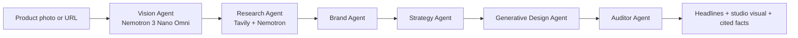

# AgentArt AI

AgentArt AI turns one product photo into an ad campaign that is safe to publish. Six NVIDIA Nemotron agents, running on Nebius Token Factory, look at the photo, research the product on the web, write the headlines and then audit every claim before anything reaches the user.

Built for the Nebius x NVIDIA Global AI Hackathon 2026, track: Best Apps and Agents.

## Why it exists

Small sellers cannot afford an ad agency, and generic AI copy tends to invent claims ("the fastest", "number one", made-up specs). In many places that is false advertising. AgentArt AI treats the claim check as a first-class step: headlines may only use what the agents saw in the photo or found in a cited web source.

## How it works



| Agent | Model | What it does |
| --- | --- | --- |
| Vision | `nvidia/Nemotron-3-Nano-Omni` | Looks at the photo: product, colors, setting, white backdrop or not. Never transcribes license plates or faces. |
| Research | Tavily search + Nemotron 3.5 Lightning | Searches the web for the product and keeps only facts that appear in the results, each tied to a source URL. |
| Brand | Nemotron 3.5 Lightning | Defines audience, tone and positioning from the evidence. |
| Strategy | Nemotron 3.5 Lightning | Picks one big idea and drafts three headlines. |
| Generative Design | Nemotron 3.5 Lightning | Art-directs the dark studio set (scene description and palette). |
| Auditor | Nemotron 3.5 Lightning | Rejects or rewrites any headline whose claims the evidence cannot support, and reports what it changed. |

Each agent is a separate model call. Results stream to the browser as they finish, so the pipeline view shows real progress and what every agent concluded. If the Vision or Research agent is unavailable (for example, no Tavily key), the pipeline marks it as skipped and continues with the evidence it has.

## Stack

Next.js 14 (App Router), TypeScript, Tailwind CSS, deployed on Vercel. Inference through the OpenAI-compatible Nebius Token Factory API.

## Run it locally

```bash
npm install
cp .env.example .env.local   # then fill in the keys
npm run dev
```

| Variable | Required | Purpose |
| --- | --- | --- |
| `NEBIUS_API_KEY` | yes | Nebius Token Factory key. Only read on the server. |
| `NEBIUS_MODEL` | no | Text model. Defaults to `nvidia/Nemotron-3_5-Lightning`. |
| `NEBIUS_VISION_MODEL` | no | Vision model. Defaults to `nvidia/Nemotron-3-Nano-Omni`. |
| `TAVILY_API_KEY` | no | Enables the Research Agent. Without it the agent is skipped. |
| `NEBIUS_BASE_URL` | no | Defaults to `https://api.tokenfactory.nebius.com/v1`. |

On Vercel, add the same variables under Project Settings, Environment Variables, and redeploy. Keys are never sent to the browser.

## Design notes

- **Reasoning is switched off per request** (`chat_template_kwargs: {enable_thinking: false}`) because the agents return small JSON objects and thinking tokens only added latency. If a deployment rejects the setting, the server retries without it.
- **The studio visual is CSS, not a generated image.** The photo is shown in a dark, ambient-lit frame. For products on a white backdrop, `mix-blend-mode: multiply` lets the white disappear into the light. The Vision Agent decides which treatment to use. The Download button bakes the same look into a PNG on the client when the image source allows it (uploads, or hosts that send CORS headers).
- **Uploads are shrunk in the browser** to a small JPEG before the Vision Agent sees them, so requests stay far below hosting body limits.
- **Web text is treated as untrusted.** Search results are passed to the model as data, with an instruction to ignore any commands inside them.

## Known limitations

- Headlines are generated in English only.
- The studio visual is a styling of the original photo, not a newly generated scene.
- Vision quality depends on the model and on the photo. Brand or model names are only reported when clearly visible.
- The Research Agent can only be as good as what Tavily returns for the product name.

## License

MIT. See [LICENSE](LICENSE).
